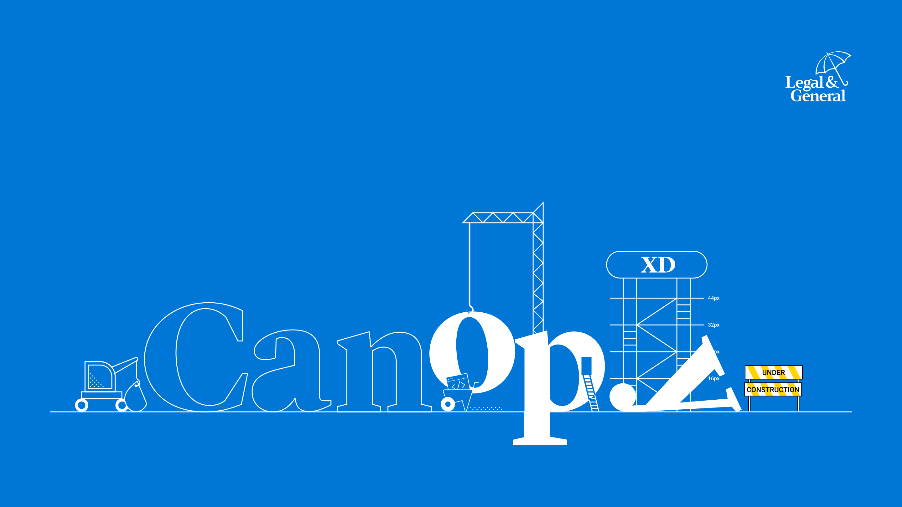

# Canopy

> [!WARNING]
> **We're making big changes to Canopy for L&G's brand modernisation throughout 2025-2026.**
> 
> We want to keep you up to date with the planned roll out and give you the support you need.
> 
> Please [email us](mailto:CanopyDesignSystem@landg.com?subject=Tell%20me%20about%20Canopy%20updates%20(GH)) and let us know which application or project you are using Canopy for and we'll get in touch.

> An Angular implementation of the Legal & General design system.

## Documentation

[Canopy Storybook](https://legal-and-general.github.io/canopy/) is the home of
our documentation for designers and developers. Explore the component guides,
design principles and examples, or start with:

- [Installing and using Canopy](https://legal-and-general.github.io/canopy/?path=/docs/development-using-canopy-installation-and-usage--docs)
- [Contributing to Canopy](https://legal-and-general.github.io/canopy/?path=/docs/development-contributing-overview--docs)
- [Releases](https://legal-and-general.github.io/canopy/?path=/docs/development-contributing-releases-overview--docs)
- [Best practice skills](https://legal-and-general.github.io/canopy/?path=/docs/ai-best-practice-skills--docs) and [migration skills](https://legal-and-general.github.io/canopy/?path=/docs/ai-migration-skills--docs)
- [Contributor agents and workflows](https://legal-and-general.github.io/canopy/?path=/docs/development-contributing-agents-and-workflows--docs)

The [source guides](docs/) are also available on GitHub, including the
[AI skills catalogue](docs/COPILOT_SKILLS.md).

## Get involved

Please follow our [code of conduct](docs/CODE_OF_CONDUCT.md). Read the
[security policy](docs/SECURITY.md) for reporting vulnerabilities and the
[licence](LICENSE.md) for terms of use.

Raise an [issue](../../issues) or [request a feature](../../discussions).
