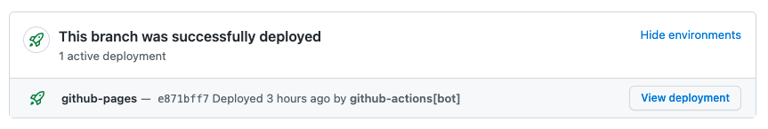

# Contributing

Hi, we’re glad you’re here! All contributions are welcome.

Before you start Contributing to Canopy it is worth familiarising yourself with the [best practice](./BEST_PRACTICE.md) guidelines.

Please do raise an [issue](https://github.com/Legal-and-General/canopy/issues) or [discussion](https://github.com/Legal-and-General/canopy/discussions) before starting a piece of work. Our contributors can help provide guidance to make sure your effort isn't wasted. It is important that the development and design implementations stay in sync and that the codebase remains consistent. This will help to give the codebase a long life and remain intuitive for those using it.

## Getting started

Use the Node version specified in `.nvmrc` (for example, run `nvm use`) and
install dependencies with `npm ci` from the repository root. See the
[GitHub registry setup](./USAGE.md#setting-up-the-github-registry) and
[authentication](./USAGE.md#authenticating-against-the-github-registry) guidance
if you need to configure access to packages.

For commit messages, follow the [Conventional commits](#conventional-commits)
guidance.

## Coding standards

- **Design and API:** Match Canopy designs so consumers do not need custom
  styles. Use standalone Angular components and directives, `lg`-prefixed
  selectors and `Lg` class names. Keep typed inputs, outputs and defaults
  consistent with related components. Form controls should integrate with Angular
  forms, for example through `ControlValueAccessor` where appropriate.
- **Structure and exports:** Keep a component's implementation, template,
  styles and tests together under `projects/canopy/src/lib/`, with stories and
  a guide in its `docs/` subfolder. Export intended public APIs through the
  component's `index.ts` and `projects/canopy/src/public-api.ts`. Check the
  [breaking changes guide](./BREAKING_CHANGES.md) before changing an existing API.
- **Styles and tokens:** Use shared design tokens for values such as colours
  and spacing: prefer component tokens, then semantic tokens, and use
  foundation tokens only when needed. Reuse shared styles and consistent
  class names; the [styles and design tokens guidance](./CODING_STANDARDS.md#styles-and-design-tokens)
  explains these with examples.
- **Accessibility and tests:** Use semantic HTML, accessible labels and
  keyboard interactions. Add unit tests for the public behaviour and relevant
  states, and run the [tests](#running-unit-tests) and [lint](#running-lint).

See the [coding standards guide](./CODING_STANDARDS.md) for more detail.

## Storybook

Canopy uses [Storybook](https://storybook.js.org/) to develop components in
isolation and document them. Run `npm start` for a local preview with hot reload.

### Component stories and guides

1. Add a `*.stories.ts` file under the component's `docs/` folder. Give its
   default export a title and component, and add named stories for representative
   variants and states. Use `args` for defaults, `argTypes` for controls and
   `moduleMetadata` for Angular imports as needed. See the
   [Separator stories](../projects/canopy/src/lib/separator/docs/separator.stories.ts).
2. Add or update `guide.mdx` with usage, applicable inputs and outputs, and
   dos and don'ts for components. Follow the
   [documentation templates](../.github/instructions/component-docs.instructions.md);
   use `<Source of={NoticeStories.StandardNotice} />` to show a story's code
   where useful, as in the [Notice guide](../projects/canopy/src/lib/notice/docs/guide.mdx).
3. Register the guide and stories in [`.storybook/main.js`](../.storybook/main.js)
   under the appropriate sidebar group, with matching title prefixes (for
   example, `Components/Separator/Guide` and `Components/Separator/Examples`).
   Use `npm start` to check the guide, examples, controls, displayed source and
   accessibility, then run `npm run build:storybook`. Stories also support
   [visual regression testing](#running-visual-tests).

### Repository guides

The repository guides are kept in Markdown, mostly in `docs/`, and are also
displayed in Storybook. Keep those Markdown files as the source of truth so
they remain available on GitHub and the AI skill generators can update the
skills catalogue.

The Storybook pages in `projects/canopy/src/lib/docs/repository-guides/` import
the Markdown files and are registered in `.storybook/main.js`. Add new guide
links to `repository-links.cjs` so links between guides stay within the current
Storybook deployment. Images in `docs/assets/` are served by Storybook.
The AI skills pages share `docs/COPILOT_SKILLS.md`: retain its `Migration Skills`
and `Best Practice Skills` headings so Storybook can render each section.
Update `SKILL_ANCHOR_ROUTES` in `repository-links.cjs` when adding or renaming
linked catalogue headings.

### Component design tokens

Component design tokens are shown in the Storybook component add-on. To add a component, add an entry to `.storybook/component-token-sources.js`:

```javascript
{
   label: 'Notice',
   titlePrefix: 'Components/Notice',
   categories: ['Notice'],
}
```

- `label` is the component name displayed in the add-on tab.
- `titlePrefix` must match the component's Storybook title, including its group path. The add-on uses it to match the active story; for example, `Components/Notice` matches stories titled `Components/Notice/Examples`.
- `categories` is an array of exact, case-sensitive `@tokens` labels from the `storybook-tokens.css` file supplied by `@legal-and-general/canopy-design-tokens`. Add every relevant category when a component has tokens split across multiple labels, as with Button's `['Button', 'Button Group']`. These are category labels, not presenter names or CSS variable prefixes.

After adding or changing an entry, run `npm run build:storybook` and check the component's Design tokens add-on tab.

### Deployments

Pull requests are deployed manually to [GitHub Pages](https://pages.github.com/) by the Core or Regular Contributors.
Once the deployment has completed successfully the pull request will be updated with the environment details.



The `master` branch is also deployed to GitHub Pages, this currently provides the most up-to-date documentation for the latest version.

https://legal-and-general.github.io/canopy

## Build

Run `npm run build` to build the library and global styles.

The build artifacts will be stored in the `dist/` directory.

### Build test application

A test application in `projects/canopy-test-app` exercises many Canopy
components together. Run `npm run build:test-app` to build it; this also runs
as part of the pull request pipeline. Use `npm run start:test-app` to serve it
locally.

## Running unit tests

Run `npm test` to execute the library unit tests, this step is also run as part of the pull request pipeline.

## Running lint

Run `npm run lint` to check the code with ESLint and Stylelint. The pull request pipeline runs these checks separately.

- `npm run eslint` checks TypeScript, JavaScript and Angular templates.
- `npm run stylelint` checks SCSS.
- The pre-commit hook uses `lint-staged` to format and lint matching staged
  source files, including formatting with Prettier.

Stylelint's `at-rule-prelude-no-invalid` rule excludes Sass `@mixin` and `@function`
declarations because their parameter syntax differs from CSS. Standard CSS at-rule
preludes remain validated.

## Running visual tests

Visual tests run using [Percy](https://percy.io/). The visual tests will take screenshots of the components and compare them to the baseline images.

### Branch environment

The visual tests run as part of the branch deployment which can only be triggered by a [Canopy Core Contributors](https://github.com/orgs/Legal-and-General/teams/canopy-core-contributors).

### Local env

Pre-requisites:
```bash
export PERCY_BRANCH='local';
export PERCY_TOKEN='<percy-token>'; # this is available in the Percy project settings
export PERCY_STORYBOOK_DOC_CAPTURE=true;
```

Run `npm run test:visual` to execute the visual regression tests locally.

## Conventional commits

This repository is set up to work with the [angular version](https://github.com/angular/angular/blob/master/CONTRIBUTING.md#-commit-message-guidelines) of [conventional commits](https://www.conventionalcommits.org).

A git commit-msg hook will lint your commits to ensure they are of the correct format. To make it easy to follow the correct format you can `npm run commit` which will use the [commitizen](https://github.com/commitizen/cz-cli) cli to run you through the process.

Commit messages determine whether semantic-release creates a release and which
version it uses. See the [releases guide](./RELEASES.md) for the release
branches and versioning rules.

### Breaking Changes

Be particularly aware of any changes which may be deemed a breaking change. Refer to our [guide of what is and is not considered a breaking change](./BREAKING_CHANGES.md)

Use a `BREAKING CHANGE:` footer, as shown in the example below. Canopy's Angular
commit convention does not support the `!` marker.

Whenever introducing a breaking change consider using the `next` branch. Refer to the [next docs](./NEXT_BRANCH.md).

### Maintenance Releases

To create bug fixes or security patches for older versions, use maintenance branches. Refer to the [maintenance releases docs](./MAINTENANCE_RELEASES.md).

### Commit message examples

Fix

```
fix(release): need to depend on latest rxjs and zone.js

The version in our package.json gets copied to the one we publish, and users need the latest of these.
```

Breaking change

```
feat(button): allow provided config object to extend other configs

BREAKING CHANGE: `extends` key in config file is now used for extending other config files
```

## Commit Signing

To ensure that changes come from an entrusted source all commits must be [signed](https://help.github.com/en/articles/about-commit-signature-verification), Follow the steps below to setup commit signing.

1. [Generating a new GPG Key](https://help.github.com/en/articles/generating-a-new-gpg-key)

   Make sure the email address you use, matches your local git email address (`git config --get user.email`) and that of your GitHub account. If not, either change your git email address or add this address to your GitHub account.

2. [Adding a new GPG key to your GitHub account](https://help.github.com/en/articles/adding-a-new-gpg-key-to-your-github-account)
3. [Signing commits](https://help.github.com/en/articles/signing-commits)

## Branch naming convention

Branches should be in `kebab-case` format.
The repository is set up with a `pre-push` hook that will prevent the user from pushing if the branch name doesn't match the correct format.

## Review Process

Pull requests require two successful approvals before they can be merged. One review must be from a [CODEOWNER](../.github/CODEOWNERS). We also require that developers working on a specific project seek review from someone on a different project. The aim being that by removing any immediate delivery pressure we can ensure a high level of quality and negate the risk of factions forming within the codebase, currently we cannot automate this process and so it must be based on trust.

### Code Owners

Code Owners are chosen based on a history of consistent contributions. Code Owners should have an understanding of the current issues list and have a wider view of the technical direction of the project. They should help to steer technical direction via pull request reviews and be focused on the longer term success of the project. Code Owners are not limited to being from our particular organisation.

## Github Actions

The build is currently handled by [Github Actions](https://help.github.com/en/actions), the config for which is checked into the [.github](https://github.com/Legal-and-General/canopy/tree/master/.github) directory. The build will run on every pull request and run standard verification tasks e.g. linting, unit testing, test build. The build will need to be green in order for a pull request to pass.

## SVG Icons

To add a new SVG icon to Canopy simply add the file to either the `icons` or `pictograms` folder within `assets`.

## Angular Material CDK

The `@angular/cdk` can be used as long as only the necessary functionality is imported. 

## Dependabot

The dependency updates are currently handled by [Dependabot](./DEPENDABOT.md).

## Agentic AI

Canopy uses GitHub Copilot coding agents to automate specific development tasks such as dependency updates. For details on the available agents, skills, and how to add new ones, see [AGENTIC_AI.md](./AGENTIC_AI.md). Canopy also publishes installable [migration skills](./COPILOT_SKILLS.md#migration-skills) and [best practice skills](./COPILOT_SKILLS.md#best-practice-skills) for consumers.
